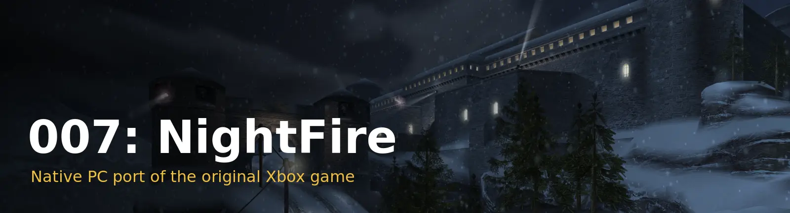
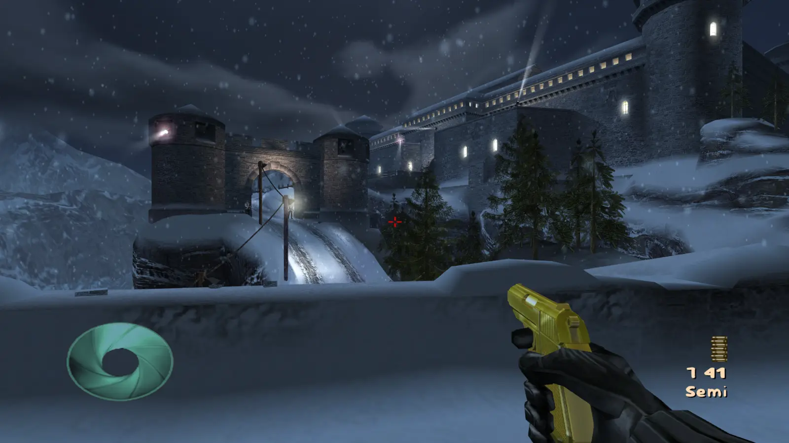
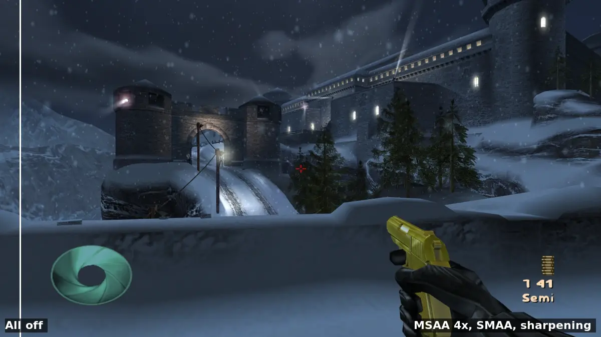
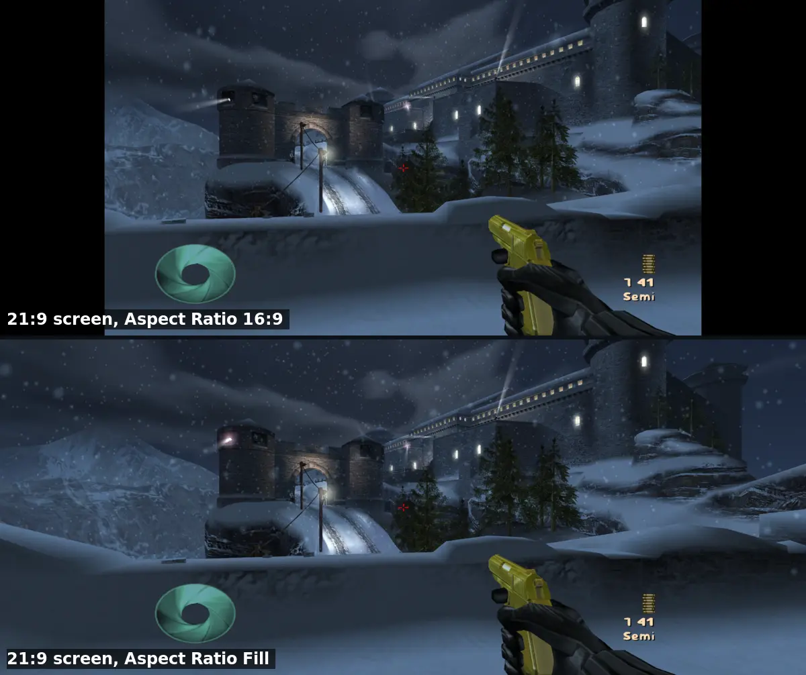
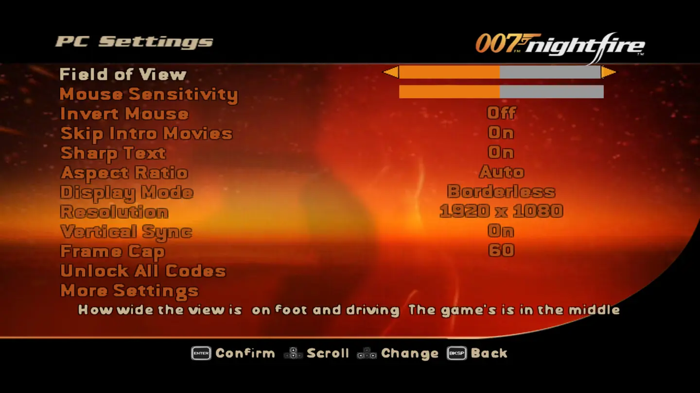
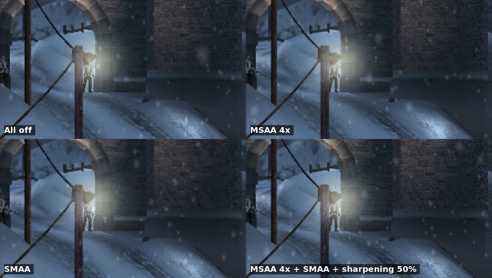
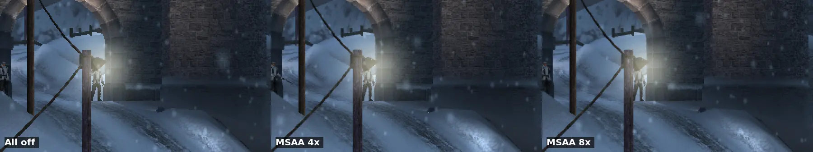
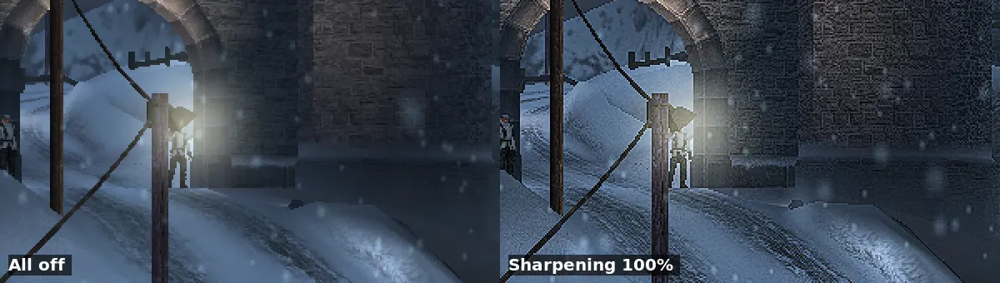

  

  
  
  

  <a href="#getting-started"><b>Getting started</b></a> &nbsp;·&nbsp;
  <a href="https://github.com/hk21x/nightfire-recomp/releases/latest"><b>Download</b></a> &nbsp;·&nbsp;
  <a href="#building"><b>Building</b></a> &nbsp;·&nbsp;
  <a href="https://discord.gg/PQjkKsdtc"><b>Discord</b></a>

  

**The 2002 Xbox Bond shooter, running natively on PC.** This is not an emulator. The game's own x86 code, on foot and
in the driving missions, is statically recompiled with the [Xbox XBE Recomp](https://github.com/TGP482/XboxXBE-Recomp)
toolkit into Windows programs, with a new renderer, sound and input underneath: widescreen and ultrawide, sharper
graphics, mouse aiming like a PC shooter, modern pads, achievements and settings inside the game's own menus.

> [!NOTE]
> This project does not include any game assets. You need your own copy of the Xbox game to play.

## Table of contents

- [Xbox vs. PC](#xbox-vs-pc)
- [Features](#features)
- [Widescreen and ultrawide](#widescreen-and-ultrawide)
- [PC Settings](#pc-settings)
- [Graphics settings](#graphics-settings)
- [Controls](#controls)
- [Achievements](#achievements)
- [Requirements](#requirements)
- [Getting started](#getting-started)
- [FAQ](#faq)
- [Known issues](#known-issues)
- [Roadmap](#roadmap)
- [Community and support](#community-and-support)
- [Building](#building)
- [Credits and legal](#credits-and-legal)

## Xbox vs. PC
[(Back to top)](#table-of-contents)

  
   
  <i>All off vs. MSAA 4x, SMAA and sharpening 50%, at 1920x1080.</i>

The Xbox drew NightFire at 640x480, at 4:3 or 16:9 for a widescreen TV. The port draws it at your screen's
resolution and shape, with anti-aliasing and sharpening on top of the game's own picture, and its text redrawn
smooth at any size.

## Features
[(Back to top)](#table-of-contents)

| | |
|---|---|
| **Widescreen and ultrawide** | The game's own 16:9 mode on a wide screen; on 21:9 and wider the 3D view widens to fill it, on foot and driving, with the HUD and menus kept at 16:9 in the middle. 16:10 screens are filled too. |
| **Sharper graphics** | Render scale, MSAA up to 8x, FXAA or SMAA, sharpening, anisotropic filtering, enhanced world textures and sharp text and HUD. |
| **Clean fonts** | The game's text, in both programs, is redrawn at eight times the console's resolution from a close match for its own face. |
| **Mouse and keyboard** | The mouse turns and aims directly, like a PC shooter, with sensitivity and invert. The driving missions' mounted guns aim with it too. Every key can be rebound. |
| **Your keys in the prompts** | While you play on the keyboard and mouse, the game's button pictures show the keys bound to them; they switch back when you pick up a pad. |
| **Controllers** | Xbox, PlayStation and Switch pads with hot plugging and rumble, a dead zone and sensitivity for each stick, and modern button pictures (A B X Y, LB and RB, LT and RT). |
| **PC Settings in the game** | A page of the game's own menus, from the main menu and the pause screen. Everything else is in the F1 window and `settings.toml`. |
| **Achievements** | 19 achievements, for every mission, medals, 00 Agent and Bond Moves, with pop-ups and a list in the F1 window. |
| **Unlock All Codes** | One button enters all 52 of the game's secret codes and keeps everything they unlock. |
| **Quality of life** | Field of view, skip the intro movies, hide the HUD for screenshots, Quit Game in the main menu, F12 screenshots at full resolution, Alt+Enter for full screen, a shader cache against stutter. |
| **The launcher** | `NightFireLauncher.exe` sets the game up from your disc in seconds and updates it: nothing installed, no admin rights. |

## Widescreen and ultrawide
[(Back to top)](#table-of-contents)

  
   
  <i>A 21:9 screen (1920x800): Aspect Ratio 16:9, then Fill. The HUD stays at 16:9 in the middle.</i>

NightFire has its own 16:9 mode for a widescreen TV, and the port uses it on any wide screen. **Aspect Ratio** in PC
Settings chooses the shape:

- **Auto** follows the screen: 16:9 on a 16:9 screen, filled on 16:10 and others between 4:3 and 16:9.
- **4:3** and **16:9** keep that shape, with black bars on a wider screen.
- **Fill** widens the 3D view to a 21:9 or wider screen, on foot and in the driving missions. The HUD and menus keep
  their 16:9 shape in the middle, and the sniper scope's black surround reaches the screen's sides.

The field of view (50 to 150%) widens or narrows the view on top of that, on foot, driving and in the engine's
cutscenes.

## PC Settings
[(Back to top)](#table-of-contents)

  

The port's main options are a page of the game's own menus: **PC Settings** in the main menu, and a choice on the
pause screen on foot (under Continue, Restart and Quit).

| Setting | What it does |
|---|---|
| **Field of View** | How wide the view is, on foot, driving and in the engine's cutscenes (the scope zooms in proportion). |
| **Mouse Sensitivity**, **Invert Mouse** | How far the view turns for the mouse's movement, and forward to look down. |
| **Skip Intro Movies** | Starts without the EA and MGM logo movies. |
| **Sharp Text** | Draws the text and HUD pictures sharp at high resolutions. |
| **Aspect Ratio** | Auto follows the screen; Fill widens the view to an ultrawide screen. |
| **Display Mode**, **Resolution** | A window, a borderless window or full screen, at any size the monitor offers. |
| **Vertical Sync**, **Frame Cap** | Frames shown with the screen's refresh, and the most drawn a second. |
| **Unlock All Codes** | Enters all 52 secret codes: levels, gadget upgrades, weapons and the multiplayer extras. |
| **More Settings** | Opens the settings window. |

**F1** opens the settings window over the game at any time: graphics, renderer, sound, controls and key bindings,
controller sticks, achievements. Changes are saved at once in `settings.toml` beside the game.

## Graphics settings
[(Back to top)](#table-of-contents)

The close-ups below are 300x170 pixels of a 1920x1080 frame, enlarged twice. The snow falls differently in each.

  
   
  <i>Edges: all off, MSAA 4x, SMAA, and all three together.</i>

- **MSAA** (2x, 4x, 8x) smooths the edges of the 3D scene and keeps textures sharp. The more samples, the slower.
- **SMAA** and **FXAA** smooth the edges in the finished frame, after it is drawn: cheaper than MSAA.
- **Render scale** draws the picture larger than the screen and shrinks it: the smoothest fine detail, and the
  slowest.

  
   
  <i>MSAA off, 4x and 8x.</i>

  
   
  <i>Sharpening off and 100%.</i>

- **Sharpening** makes the picture crisper. Around 50% is a good start; 100% turns stone walls gritty.
- **Anisotropic filtering** keeps textures sharp at a slant, like the snow on the road to the gate.

## Controls
[(Back to top)](#table-of-contents)

**On foot** (the game's NightFire controller style):

| Action | Keyboard and mouse | Pad |
|---|---|---|
| Move and strafe | W A S D | left stick |
| Look and aim | mouse (free aim, no lock-on) | right stick |
| Fire / manual aim | left / right mouse button | RT / LT |
| Action, reload | E, R | X |
| Jump | Space | Y |
| Crouch | C, Left Ctrl | A |
| Next weapon | Q, 1, mouse wheel, right arrow (left arrow or 3: the one before) | B, d-pad left and right |
| Alt. fire | middle mouse button, F | LB |
| Next gadget | G, 2 | RB |
| Gadget / zoom | up and down arrows (the mouse wheel zooms in a scope) | d-pad up and down |
| Vision mode | V, Tab | View |
| Pause | Esc, P | Menu |

**Driving missions:**

| Action | Keyboard and mouse | Pad |
|---|---|---|
| Gas / brake and reverse | W / S | RT / LT |
| Steer | A / D, left and right arrows | left stick |
| Rise / dive (Deep Descent) | up arrow, Left Shift / down arrow, Left Ctrl | left stick |
| Fire weapon | left mouse button, Enter | A |
| Gadget | right mouse button, E | X |
| Handbrake | Space | B |
| Weapons | mouse wheel, Q / Z, 1 to 4 | RB / LB, d-pad |
| Camera | C | Y |
| Look back | V, middle mouse button | right stick click |
| Pause | Esc, P | Menu |

**Everywhere:**

| Action | Keyboard | Pad |
|---|---|---|
| Settings window | F1 | View + Menu |
| Screenshot | F12 | |
| Full screen | Alt+Enter | |
| Menus | arrows move, Enter selects, Backspace goes back; or the mouse | d-pad, A, B |

On the mounted guns (the Paris van, Alpine Escape's snowmobile) the mouse aims, the left button fires, the right
button zooms and R reloads. With a scope or a launcher the mouse turns at a quarter of its speed. Keys and buttons
can be changed in the F1 window (Controls), two keys for each.

## Achievements
[(Back to top)](#table-of-contents)

19 achievements: every mission, medals, 00 Agent and Bond Moves, with pop-ups as you play and a list in the F1 window.
They are written in RetroAchievements' condition format; the set and its memory map are in
[ACHIEVEMENTS.md](ACHIEVEMENTS.md).

## Requirements
[(Back to top)](#table-of-contents)

- **Your own copy of the game:** the European (PAL) or the USA Xbox release (title id 45410026), as an `.iso` image
  of your disc or a folder with its files. The two releases run the same code; each plays its own movies and files.

  | Release | `default.xbe` (on foot, menus) | `Driving.xbe` (the driving missions) |
  | --- | --- | --- |
  | Europe (PAL; the En, Fr, De, Es, It, Nl, Sv disc) | `796222e048be3595c323b4c6d9795107132dc4ca` | `e0c41209d8979fcd03ac3d656be78759006023cb` |
  | USA (NTSC) | `7e4b8f8a54bacc61a5897ba5245fdd65bddc0752` | `8d46a023dfbd5c89d4ee04fe28b24a9620de546a` |

- **Windows 10 or 11, 64 bit**, and a graphics card with Direct3D 12 or Direct3D 11.
- **Room** for your copy of the game: 7.3 GB when the launcher has to copy your disc image (from another drive, or on
  a drive such as exFAT), nothing more when it can link to it on the same NTFS drive or use a folder of the disc's
  files. An internet connection for the package (about 76 MB).

## Getting started
[(Back to top)](#table-of-contents)

1. Download `NightFireLauncher.exe` from the [latest release](https://github.com/hk21x/nightfire-recomp/releases/latest).
2. Put it in a folder of its own (for example `C:\Games\NightFire`) and run it. Everything it makes goes in a
   `NightFire` folder beside it. Windows may warn about an unrecognised app: choose **More info**, then **Run anyway**.
3. **Your game:** choose your disc image or the folder with the disc's files. The launcher checks that it is a
   supported release.
4. Press **Get the game ready**. It downloads the package (the runtime and a compiler, with none of the game's code)
   and compiles the game's code from your disc; on a fast PC that takes about 20 seconds.
5. Press **Play**. When a new version is out, the launcher offers **Update**; your saves and settings stay.

Under `NightFire\play` are the game, `settings.toml`, `hdd\` (your saves), `logs\` and `screenshots\`; the
launcher's own log is `NightFire\launcher.log`. To remove everything, delete the launcher and its `NightFire` folder
(keep `play\hdd` if you want your saves).

## FAQ
[(Back to top)](#table-of-contents)

<b>Is this an emulator?</b>

 
No. The game's x86 code is translated ahead of time into C++ and built as Windows programs: <code>Nightfire.exe</code>
on foot and in the menus, <code>NightfireDriving.exe</code> for the driving missions, which the game switches between
on its own as the Xbox did. The Xbox's graphics, sound and input are rebuilt for the PC underneath. That is what makes
ultrawide, mouse aiming and settings inside the game's menus possible.

<b>Why a recompilation and not the PC version?</b>

 
NightFire on PC was a different game, by a different developer: its own missions and engine. The Xbox version, with
its driving missions, never came to PC until now. A recompilation keeps that game exactly as it was and lets us
change it in source: the renderer, the controls and the menus are ours to extend.

<b>Why do I need my own copy of the game?</b>

 
The game belongs to its rights holders. This project shares only its own work: the release holds the runtime and a
compiler, and the game's code is made from your disc on your PC.

<b>Can it run above 60 frames a second?</b>

 
Not yet. The game runs its world in fixed steps of a sixtieth of a second, so drawing more frames means making the
frames in between, which NightFire does not have yet. The driving missions run at 60 on both discs (the European disc
ran them at 50 on a PAL Xbox).

<b>Does it run on Linux or the Steam Deck?</b>

 
There is no Linux build, but the Windows version runs under Proton: see
<a href="https://github.com/hk21x/nightfire-recomp/issues/4">issue #4</a> for a working setup.

<b>Something is wrong. What should I send?</b>

 
<ul>
<li>The game's log is in <code>NightFire\play\logs</code>; its first lines list your settings and graphics card. The
launcher's is <code>NightFire\launcher.log</code>. Please include them when you report a problem on the
<a href="https://discord.gg/PQjkKsdtc">Discord server</a>.</li>
<li>"The game could not start NightfireDriving.exe" when a driving mission starts: Windows Security may have
quarantined it (Protection history: allow it on your device).</li>
<li>A short stutter the first time an area or effect appears is its shaders compiling. They are kept in
<code>shadercache.bin</code>, so it does not happen there again.</li>
<li>To start again from a first boot, delete the <code>hdd</code> folder beside <code>Nightfire.exe</code>. This
deletes your saves.</li>
</ul>

## Known issues
[(Back to top)](#table-of-contents)

- **60 frames a second at most**, on foot and driving (see the FAQ).
- **Deep Descent** steers with the keys or a pad; mouse steering for the submarine is still to come.
- **Not yet covered by testing:** split-screen multiplayer and system link.

## Roadmap
[(Back to top)](#table-of-contents)

- **Frames above 60**, drawn between the game's steps.
- **Mouse steering in Deep Descent**, like the tank in the Everything or Nothing port.
- **Gyro aiming** for pads that have it.

## Community and support
[(Back to top)](#table-of-contents)

Join the [Discord server](https://discord.gg/PQjkKsdtc) for help getting the game running, to report problems, and
to talk about the port with other players. Progress is in [PROGRESS.md](PROGRESS.md), and technical findings in
[FINDINGS.md](FINDINGS.md).

## Building
[(Back to top)](#table-of-contents)

For developers.

1. Clone with submodules: `git clone --recurse-submodules https://github.com/hk21x/nightfire-recomp.git` (cloned
   without them? `git submodule update --init`).
2. Put your game files in `assets`: `default.xbe` with `Driving.xbe` and the game's folders (`eurocom`, `driving` ...)
   beside it, or your disc's `.iso`.
3. Install Visual Studio 2022 (Community is fine) with **Desktop development with C++** (`build.bat` offers to add
   **C++ Clang tools for Windows** and **C++ CMake tools for Windows**), and run `build.bat`. The first build
   recompiles both xbes and takes a while. The game is `out\build\release\Nightfire.exe`; it finds `assets` beside
   itself or in any folder above it.

Each program's code is a DLL (`Nightfire.dll`, `NightfireDriving.dll`). For a release, `release-package.bat` (after
`build.bat`) makes `NightFire-package.zip` and its `.json`; a tag makes a draft release with the launcher, and the
package is attached by hand before it is published. Game code is never uploaded. `launcher.bat` builds
`NightFireLauncher.exe`.

## Credits and legal
[(Back to top)](#table-of-contents)

- [Xbox XBE Recomp](https://github.com/TGP482/XboxXBE-Recomp), the recompiler and runtime this is built on.
- [XenonRecomp](https://github.com/hedge-dev/XenonRecomp) for the overridable function layout and instruction hooks.
- [Zydis](https://github.com/zyantific/zydis) for decoding x86 instructions, [toml++](https://github.com/marzer/tomlplusplus)
  for the configs, [Dear ImGui](https://github.com/ocornut/imgui) for the settings overlay and
  [SDL](https://github.com/libsdl-org/SDL) for the window, input and controllers.
- [Sour Gummy](https://github.com/eifetx/Sour-Gummy-Fonts) by the Sour Gummy Project Authors, under the SIL Open Font
  License (`third_party/fonts/OFL.txt`), and [stb_truetype](https://github.com/nothings/stb) for drawing it.

The port's own code is under the MIT License ([LICENSE](LICENSE)); the SDK and the third-party parts under theirs
(`sdk/LICENSE`, `sdk/THIRD_PARTY.txt`, `third_party/`).

*007: NightFire* © its respective rights holders. Developed by Eurocom and published by Electronic Arts. James Bond
and 007 are trademarks of their owners. This is an unofficial fan project, not affiliated with or endorsed by them.
No game code or assets are distributed: they are made from your own copy of the game.

**AI disclosure:** much of this project's code, tooling and documentation was written with AI assistance (Anthropic's
Claude), directed, reviewed and playtested by the author.
