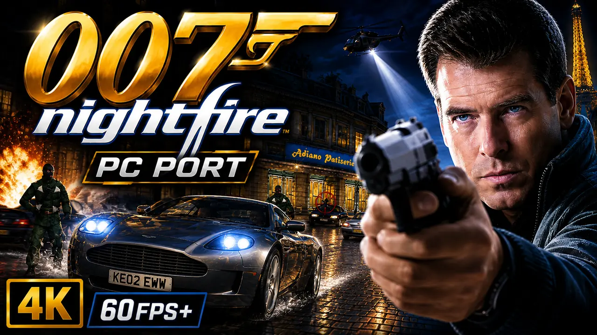

# 007: NightFire - XBE Recomp



An unofficial native PC port of the original Xbox version of 007: NightFire, with extended graphics options and other
enhancements. The game's own x86 code is statically recompiled into Windows executables with the
[Xbox XBE Recomp](https://github.com/TGP482/XboxXBE-Recomp) tool; the Xbox's graphics, sound and system libraries are
reimplemented for Windows (Direct3D 12 or 11, XAudio2, SDL). It is not an emulator.

> [!NOTE]
> This project does not include any game assets. You must provide the files from your own legally acquired copy of
> the game to build and play.

## Supported Version

The European (PAL) Xbox release of 007: NightFire (title id 45410026):

| File | SHA-1 |
| --- | --- |
| `default.xbe` (on foot, menus) | `796222e048be3595c323b4c6d9795107132dc4ca` |
| `Driving.xbe` (the driving missions) | `e0c41209d8979fcd03ac3d656be78759006023cb` |

The game is two programs: the driving missions (Paris Prelude, Alpine Escape, Enemies Vanquished, Deep Descent,
Island Infiltration) are a second xbe that the game launches and returns from. Both are recompiled, into
`Nightfire.exe` and `NightfireDriving.exe`, and the switch between them happens on its own. The log names the SHA-1 of
each xbe it found. Other releases (NTSC, for example) have not been checked.

## Getting Started

There are two ways to get the game running. Both build it on your own PC from your own disc: the game's code is
never downloaded, only the tools and this project's source.

### The launcher (recommended)

`NightFireLauncher.exe` does everything for you: no Visual Studio, no Git, no command line, nothing installed in
Windows and no admin rights needed.

**You need:**
- Windows 10 or 11, 64 bit, and a GPU with Direct3D 12 or Direct3D 11.
- Your own copy of the game (PAL): an `.iso` image of your disc, or a folder with the disc's files.
- About 15 GB free, and an internet connection for the build tools.

**Steps:**
1. Download `NightFireLauncher.exe` from the [latest release](https://github.com/hk21x/nightfire-recomp/releases/latest).
2. Put it in a folder of its own (for example `C:\Games\NightFire`) and run it. Everything it makes goes in a
   `NightFire` folder beside it. Windows may warn about an unrecognised app: choose **More info**, then **Run anyway**.
3. **Your game:** choose your disc image or the folder with the disc's files. The launcher checks that it is the
   supported release.
4. **Build:** accept the license terms for Microsoft's C++ libraries and Windows SDK (the build uses them), then press
   **Build**. It downloads portable build tools (Clang, CMake, Ninja, Git and Microsoft's libraries), this project's
   source, and builds the game. The first build takes 30 to 90 minutes. You can stop it at any time; it carries on
   where it left off.
5. **Play:** press **Play**.

When this project is updated the launcher shows **Update**: press it, then Play.

Files, all under the `NightFire` folder beside the launcher:
- `play\` the game: `Nightfire.exe`, `NightfireDriving.exe`, `settings.toml`, `hdd\` (saves), `logs\` (the game's logs)
- `launcher.log` the launcher's log (send it with any problem building)
- `tools\` and `source\` the build tools and the source

To remove everything, delete the launcher and its `NightFire` folder (keep `play\hdd` if you want your saves).

### Building from source (developers)

**You need:** Windows 10 or 11 (64 bit), [Git](https://git-scm.com/download/win), Visual Studio 2022 (Community is
fine) with **Desktop development with C++** (`build.bat` offers to add **C++ Clang tools for Windows** and **C++ CMake
tools for Windows**), about 15 GB free, and your disc's files: `default.xbe`, `Driving.xbe` and the game's folders.

1. Clone the repository with its SDK:
   ```
   git clone --recurse-submodules https://github.com/hk21x/nightfire-recomp.git
   cd nightfire-recomp
   ```
   Cloned without `--recurse-submodules`? Run `git submodule update --init`.
2. Put your game files in the `assets` folder: `assets\default.xbe` with `Driving.xbe` and the game's folders
   (`eurocom`, `driving` ...) beside it, or your disc's `.iso`.
3. Run `build.bat`. The first build recompiles both xbe files and takes 30 to 90 minutes; later builds are quicker.
4. Run `out\build\release\Nightfire.exe`. It finds the `assets` folder beside itself or in any folder above it.

`launcher.bat` builds `NightFireLauncher.exe` itself. Files the game writes beside the exe: `settings.toml`, `hdd\`
(saves; delete it to start again from a first boot), `logs\`, `shadercache.bin` (compiled shaders) and `CrashDumps\`
if it crashes.

## Controls and Settings

**PC Settings:** in the game's own menus, as the main menu's **PC Settings** item: field of view, mouse sensitivity
and invert, skip intro, sharp 2D, aspect, display mode, resolution, vsync and frame cap. **F1** opens the full
settings window (graphics, renderer, controls) at any time; changes are saved at once to `settings.toml`.

**Keyboard and mouse on foot** (remappable in the settings window's Controls tab, two keys per input):

| Action | Keys |
| --- | --- |
| Move and strafe | W A S D |
| Look and aim | Mouse (free aim: no lock-on while the mouse plays) |
| Fire / manual aim | Left / right mouse button |
| Action, reload | E, R |
| Jump | Space |
| Crouch | C or Left Ctrl |
| Weapons | Mouse wheel, or the left and right arrows / 3 and 4 |
| Next weapon | Q |
| Alt. fire | Middle mouse button or F |
| Next gadget | G |
| Gadget / zoom | Up and down arrows, or 1 and 2 |
| Vision mode | V or Tab |
| Pause | Esc or P |

With a scope or a launcher the mouse turns at a quarter of its speed, and a guided missile steers with the mouse.
Keypads (door codes) take the left mouse button or Enter. In the menus the mouse wheel scrolls, Enter selects and
Backspace goes back.

**Driving missions** have a layout of their own (rebound apart from the on-foot keys):

| Action | Keys |
| --- | --- |
| Gas / brake and reverse | W / S |
| Steer | A / D, or the left and right arrows |
| Fire weapon | Left mouse button or Enter |
| Gadget | Right mouse button or E |
| Handbrake | Space |
| Weapons | Mouse wheel, Q / Z, or 1 to 4 |
| Camera | C |
| Look back | V or middle mouse button |
| Pause | Esc or P |

On the mounted guns (the Paris van, Alpine Escape's snowmobile turret) the mouse aims, the left button fires, the
right button zooms and R reloads.

**Controllers:** Xbox, PlayStation and Switch controllers, with hot plugging and rumble.

## Features

### Display
- **Display Modes** - Fullscreen, borderless window or window, at any resolution the monitor offers.
- **Widescreen** - The game's own 16:9 mode on a widescreen display.
- **Ultrawide** - With `aspect = "screen"`, the 3D view widens to fill a 21:9 or wider screen, on foot and in the
  driving missions; the HUD and menus keep their 16:9 shape in the centre.
- **Field of View** - `fov_percent` (50 to 150, 100 the game's) widens or narrows the view on foot, driving and in
  the engine's cutscenes; the scope zooms in proportion.
- **Frame Rate** - Vsync, a frame rate cap and an FPS counter.

### Graphics
- **Render Scale** - Renders at a percentage of the screen.
- **Anisotropic Filtering** and **Antialiasing** (MSAA or FXAA).
- **Clean Fonts** - The game's text, in both xbes, is redrawn at eight times the console's resolution from
  [Sour Gummy Black](https://fonts.google.com/specimen/Sour+Gummy), a close match for the game's own face, so it stays
  smooth at any resolution.
- **Sharp Text and HUD** - The menus' and HUD's pictures are enlarged with sharp edges for high resolutions
  (`sharp_2d`, on by default).
- **Shader Cache** - Compiled shaders are kept in `shadercache.bin`, so each is compiled once rather than in every
  session, and later sessions do not stutter while they compile.

### Keyboard and Mouse
- **Mouse aiming** - The mouse turns the view and aim directly, like a PC shooter (not through the stick's curve),
  with sensitivity and invert options, and with no auto-aim while it plays. The driving missions' mounted guns aim
  with it too.
- **Keyboard prompts** - While you play on the keyboard and mouse, the game's button pictures (tutorials, menus, the
  controls pages, both xbes) show the keys and mouse buttons bound to them; they switch back when you pick up the
  controller.
- Every key and mouse button can be rebound in the settings window (F1, Controls tab).

### General
- **Launcher** - `NightFireLauncher.exe`: choose your disc, Build, Play, Update; portable build tools, nothing
  installed.
- **PC Settings in the game's menus** - A native page in the game's own menus (see above).
- **Achievements** - 19 achievements (every mission, medals, 00 Agent, Bond Moves) with pop-ups and a list in the
  settings window, written in RetroAchievements' condition format; the set and its memory map are in
  [ACHIEVEMENTS.md](ACHIEVEMENTS.md).
- **Skip Intro Movies** - `skip_intro = true` starts without the EA and MGM logo movies.
- **Saves** - Kept on an emulated hard disk beside the exe.

### Miscellaneous
- **Boot Splash** - Place a `splash.png` (or `.bmp`) beside the exe to display a splash screen at launch.
- **Diagnostics** - Logs in `logs\`, and frame captures (F3, with `XBE_CAPTURE_DIR` set).

## Status

Plays on foot and in the driving missions on Windows, with saves; mouse aiming, the keyboard prompts, clean fonts,
PC Settings, widescreen and ultrawide are in. Progress is in [PROGRESS.md](PROGRESS.md), and technical findings in
[FINDINGS.md](FINDINGS.md).

## Troubleshooting

- Something wrong: the first lines of the log in `logs\` list the settings, the GPU and any `XBE_*` or `NF_*`
  environment variables; leftover ones from experiments change how the game runs.
- The launcher's build failing: send `NightFire\launcher.log`. Press Build again after a network problem: it carries
  on where it stopped.
- A build failing with "permission denied" on `Nightfire.exe` or `NightfireDriving.exe`: the game is still running;
  close it and build again.
- A short stutter the first time a new area or effect appears: its shaders are being compiled. They are kept in
  `shadercache.bin`, so it does not happen there again.
- A first boot again: delete the `hdd` folder beside `Nightfire.exe` (`NightFire\play\hdd` with the launcher,
  `out\build\release\hdd` when built from source). This deletes your saves.

## System Requirements

- **OS** - Windows 10 or 11, 64 bit
- **GPU** - with support for Direct3D 12 or Direct3D 11 (F1, Graphics, Renderer; applies at the next start)

## Credits

- [Xbox XBE Recomp](https://github.com/TGP482/XboxXBE-Recomp), the recompiler and runtime this is built on.
- [XenonRecomp](https://github.com/hedge-dev/XenonRecomp) for the overridable function layout and instruction hooks.
- [Zydis](https://github.com/zyantific/zydis) for decoding x86 instructions, [toml++](https://github.com/marzer/tomlplusplus) for the configs, [Dear ImGui](https://github.com/ocornut/imgui) for the settings overlay and [SDL](https://github.com/libsdl-org/SDL) for the window, input and controllers.
- [Sour Gummy](https://github.com/eifetx/Sour-Gummy-Fonts) by the Sour Gummy Project Authors, under the SIL Open Font
  License (`third_party/fonts/OFL.txt`), and [stb_truetype](https://github.com/nothings/stb) for drawing it.
