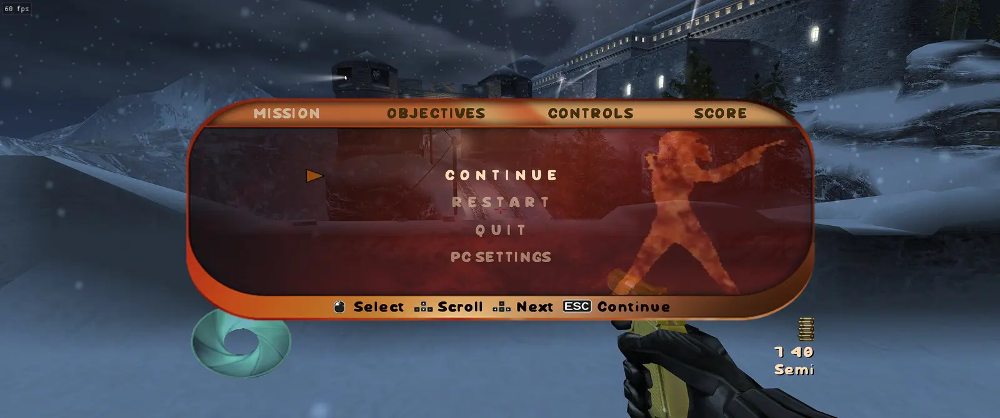

A fix release of the unofficial native PC port of 007: NightFire (original Xbox).

## Building on a drive such as exFAT: fixed

On a drive that does not record file owners (exFAT, FAT32 and some network shares), the build stopped just after
downloading the source, with `detected dubious ownership in repository` in the launcher's log, and pressing Build
again stopped in the same place. The launcher now builds on these drives, carrying on from where it stopped. You do
not need to change any Git settings. If you added a `safe.directory` exception for this, it does no harm.

## Clean text, and PC Settings on the pause screen

The game's pixelated text is redrawn from a real font (Sour Gummy Black), smooth at any resolution, in the menus and the
HUD on foot and in the driving missions. PC Settings is a choice on the on-foot pause screen as well as the main menu.

## New graphics settings

MSAA and FXAA are now separate, and there is a new sharpening setting (F1, Graphics; your old antialiasing setting
carries over). The [README](https://github.com/hk21x/nightfire-recomp#graphics-settings) compares them.

## Other changes

- The launcher's log now records what its check for new releases found.
- The mouse wheel zooms a sniper scope, and the zoom resets when you leave it; 1 switches weapon and 2 gadget on foot;
  Left Shift and Left Ctrl pitch in the driving missions.
- Updates to the shared runtime from the wider project.

Help and reports: the [Discord server](https://discord.gg/PQjkKsdtc).

## Updating

Open **NightFireLauncher.exe**: it should offer this release at the top. Press **Update the launcher**, and when it has
restarted press **Build**. If no offer appears, download **NightFireLauncher.exe** below and put it in place of the old
one. Your disc choice, saves and settings stay as they are.

No game files are included. You need your own copy of the game (the European PAL or the USA release). See the
[v1.0.0 notes](https://github.com/hk21x/nightfire-recomp/releases/tag/v1.0.0) for everything in the port.

Problems: the game's log is in `NightFire\play\logs`, the launcher's in `NightFire\launcher.log`.
